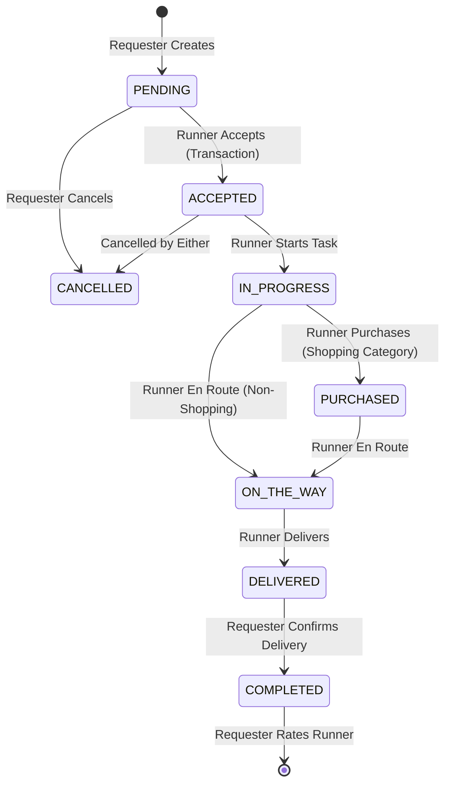

# 🛵 Hatli (هاتلي) — Hyper-Local Delivery & Service Marketplace

[](https://developer.android.com/studio)
[](https://kotlinlang.org)
[](https://developer.android.com/jetpack/compose)
[](https://developer.android.com/topic/architecture)

**Hatli** is a production-grade, city-based hyper-local delivery and service marketplace application built for Android. It bridges the gap between **Requesters** (users needing errands, shopping, document pickups, or bill payments done) and **Runners** (fulfillers performing tasks within their city).

---

## 🌟 Key Product Features

* 🔄 **Dual User Roles (Requester & Runner):** Seamless transition between posting local requests and accepting nearby jobs.
* 📝 **Multi-Category Wizard:** Specialized request creation workflows for Shopping, Pickup/Dropoff, Bill Payments, and Custom Tasks.
* ⚡ **Real-Time Request Lifecycle Engine:** Strict state machine managing request states (`PENDING` ➔ `ACCEPTED` ➔ `IN_PROGRESS` ➔ `PURCHASED` ➔ `ON_THE_WAY` ➔ `DELIVERED` ➔ `COMPLETED`).
* 💬 **In-App Real-Time Chat:** Direct communication sub-collection streams bound to active request IDs.
* ⭐️ **Runner Rating & Feedback:** Post-completion review workflow.
* 🌙 **Design System & Theme Support:** Full light and dark theme palette built with Material 3 and custom token extensions.

---

## 🏗️ Architecture & Technical Design

The project is structured according to **Clean Architecture** principles and **Google's Modern Android Development (MAD)** recommendations:

```mermaid
flowchart TD
    subgraph Presentation Layer [Presentation Layer (:feature:* & :core:ui)]
        UI[Jetpack Compose UI]
        VM[BaseViewModel / UiState]
    end

    subgraph Domain Layer [Domain Layer (:core:domain & :core:model)]
        UC[UseCases]
        R_INT[Repository Interfaces]
        M[Pure Kotlin Models]
    end

    subgraph Data Layer [Data Layer (:core:data & :core:network)]
        R_IMPL[Repository Implementations]
        DS_REMOTE[Firestore / Auth DataSources]
        MAPPER[Domain & DTO Mappers]
    end

    UI -->|Events| VM
    VM -->|State / Effects| UI
    VM --> UC
    UC --> R_INT
    R_IMPL -.->|Implements| R_INT
    R_IMPL --> DS_REMOTE
    DS_REMOTE --> MAPPER
    MAPPER --> M
```

### Module Structure

```
Hatli/
├── app/                        # Main Application entry point & NavHost
├── build-logic/                # Custom Gradle Kotlin Convention Plugins
├── core/
│   ├── common/                 # Result wrappers, AppError, Dispatcher qualifiers
│   ├── model/                  # Pure Kotlin domain entities
│   ├── domain/                 # Business UseCases & Repository Interfaces
│   ├── data/                   # Repository implementations & Firebase data sources
│   ├── ui/                     # BaseViewModel, UDF contracts, Navigator
│   └── designsystem/           # HatliTheme, Colors, Typography, Components
└── feature/
    ├── auth/                   # Splash, Onboarding, Phone OTP, Profile Setup
    ├── home/                   # Requester & Runner Home Shell & Marketplace feeds
    ├── request/                # Create Wizard, Detail Timeline, Rate Runner
    ├── chat/                   # Real-time messaging thread
    └── profile/                # User profile management & settings
```

---

## 🔄 Request Lifecycle State Machine



---

## 🛠️ Tech Stack & Libraries

* **Language:** Kotlin 2.0 (100% Idiomatic Kotlin)
* **UI Framework:** Jetpack Compose with Material 3 Design System
* **Architecture Pattern:** MVVM + Unidirectional Data Flow (UDF) + Clean Architecture
* **Dependency Injection:** Dagger Hilt
* **Asynchronous Flow:** Kotlin Coroutines & `StateFlow` / `SharedFlow` / `callbackFlow`
* **Backend Replacement:** Firebase Auth (Phone OTP), Cloud Firestore (Real-time listeners & transactions)
* **Local Persistence:** Jetpack DataStore Preferences
* **Build System:** Gradle Version Catalog (`libs.versions.toml`) & Gradle Convention Plugins (`build-logic`)
* **Image Loading:** Coil Compose
* **Testing:** JUnit 4, MockK, Turbine, Kotlinx Coroutines Test

---

## 🧪 Testing Setup

Unit tests cover critical domain state transitions, UseCases, and ViewModels:

```bash
# Run unit tests across modules
./gradlew test

# Run Android instrumented tests
./gradlew connectedAndroidTest
```

---

## 🚀 Getting Started

1. **Clone the repository:**
   ```bash
   git clone https://github.com/AhmedKhaled2711/Hatli.git
   cd Hatli
   ```

2. **Open in Android Studio:**
   Import project into Android Studio (Ladybug 2024.2+ recommended).

3. **Firebase Configuration:**
   Place your `google-services.json` inside the `app/` directory if running custom Firebase environments.

4. **Build & Run:**
   ```bash
   ./gradlew assembleDebug
   ```
