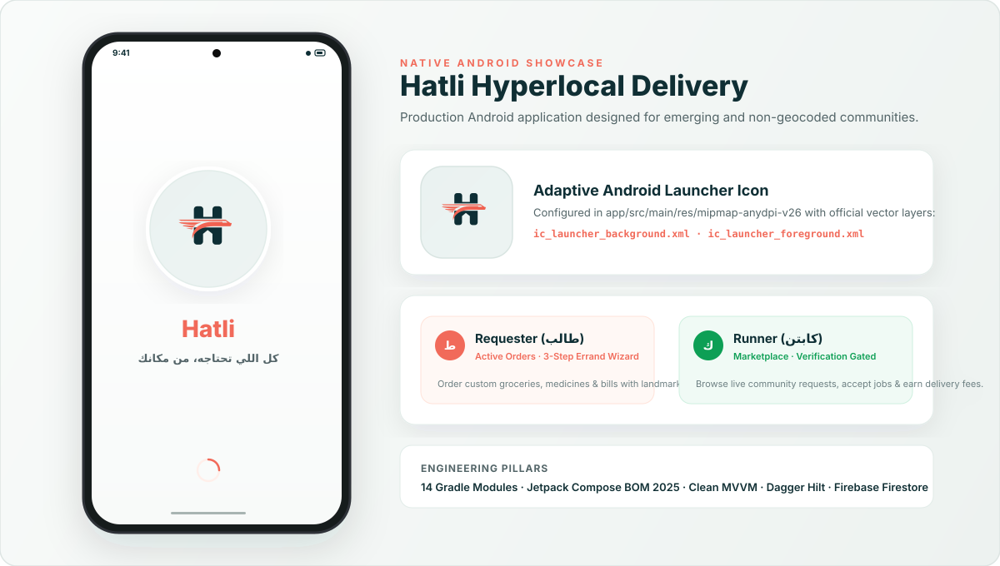
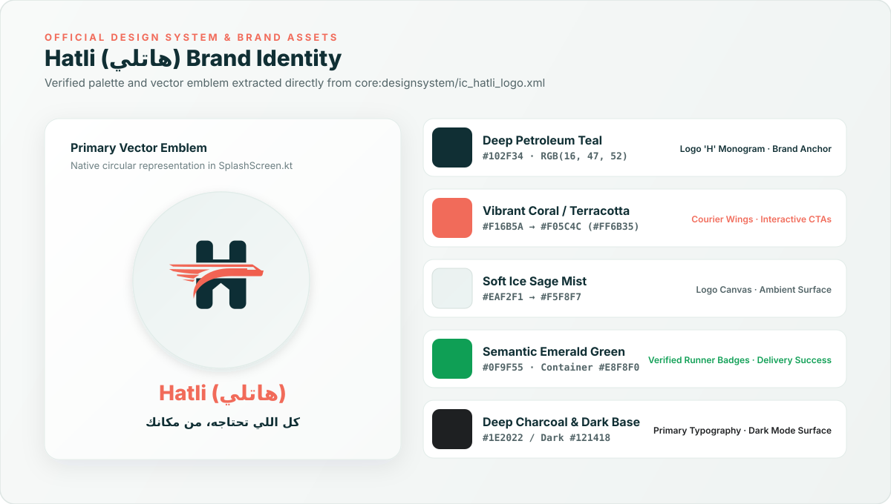
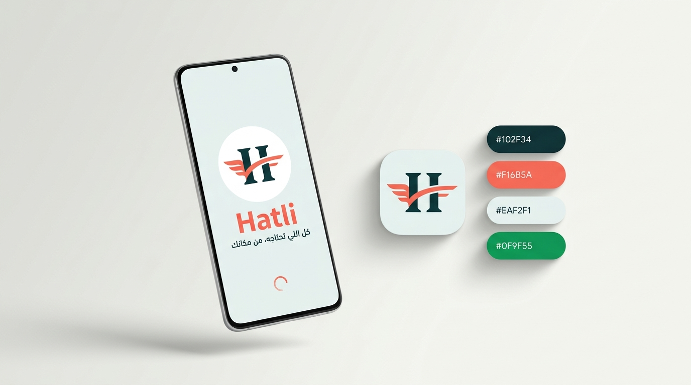

<p align="center">
  
</p>

<h1 align="center">Hatli (هاتلي) — Hyperlocal Community Errand Engine</h1>

<p align="center">
  <strong>A modular, Clean Architecture Android application built with Jetpack Compose & Material 3, enabling peer-to-peer hyperlocal deliveries in emerging and small-town communities.</strong>
</p>

<p align="center">
  
  
  
  
  
  
  <a href="LICENSE"></a>
</p>

<p align="center">
  
</p>

---

## 📖 Project Overview

**Hatli (هاتلي)** is an on-demand, peer-to-peer hyperlocal delivery and errand marketplace developed for Android. It connects **Requesters** who need everyday goods or errands completed with verified local **Runners** who fulfill those errands within the neighborhood.

### The Problem in Emerging & Small-Town Markets
Conventional on-demand delivery platforms (e.g., DoorDash, Deliveroo, UberEats) face significant operational friction in small towns and developing regions:
1. **Absence of Geocoded Street Numbers:** Most neighborhoods in small towns across the MENA region rely on landmarks and conversational instructions rather than precise geocoded building addresses.
2. **Unstructured Errands vs. Rigid Catalogs:** Small-town commerce revolves around unstructured tasks (e.g., *"Pick up medicine from Al-Nour Pharmacy and get 2 kg of bread from the bakery on Station St."*) that rigid merchant catalog carts cannot handle.
3. **Single-Role Binary Friction:** Traditional delivery platforms split drivers and consumers into two separate apps with disjointed verification pipelines, limiting community-driven peer fulfillment.

### The Hatli Solution
* **Landmark-First Navigation:** Replaces rigid building addresses with customizable landmark points and contextual micro-instructions.
* **3-Step Errand Engine:** Supports custom multi-item shopping lists, pickup-and-drop tasks, and utility payments with user-suggested delivery fees.
* **Dual-Persona Single Binary:** Seamlessly switch between **Requester (طالب)** and **Runner (كابتن)** personas in real-time within a single app.
* **Runner Verification Gate:** Strict Firestore security rules and in-app approval gates prevent unverified runners from accepting customer orders until their documents and profile are reviewed.

---

## ✨ Features

### Implemented Functionality
* **Authentication & Onboarding:**
  * Phone number authentication via Firebase Phone Auth with SMS OTP verification.
  * Sanitized Egyptian phone number formatting and validation (`PhoneSanitizer` supporting `+20` prefixes).
  * Auto-retrieval and manual OTP verification code inputs.
  * Session restoration and caching backed by Jetpack DataStore (`hatli_session`).
* **Profile & Persona Management:**
  * User profile setup with customizable name and primary role (`Requester` or `Runner`).
  * Runner transport mode selection (Walking, Bicycle, Motorcycle, Car).
  * In-app persona switcher enabling real-time toggling between Requester and Runner views.
  * Dedicated **Runner Approval Gate Screen** (`RunnerApprovalScreen`) blocking unverified runners from the marketplace until approved.
* **Errand Creation Wizard (3-Step Flow):**
  * Step 1: Category selection (Groceries, Pharmacy, Food & Drinks, Parcel Delivery, Custom).
  * Step 2: Item details, quantities, notes, and store location preferences.
  * Step 3: Landmark-first delivery location, phone contact, and suggested delivery fee slider.
* **Hyperlocal Marketplace & Discovery:**
  * **Requester Feed:** View active orders, order progress cards, and quick errand triggers.
  * **Runner Feed:** Marketplace of open `Pending` requests within the community, detailed task previews, and one-tap order acceptance (gated by verification).
* **End-to-End Request Lifecycle & Tracking:**
  * Real-time 5-stage status progression: `Pending` ➔ `Accepted` ➔ `InProgress` ➔ `Purchased` ➔ `OnTheWay` ➔ `Delivered` ➔ `Completed`.
  * Dynamic status action bars tailored to the active persona (e.g., Runner marks "Purchased", Requester confirms "Delivered & Complete").
  * Safe cancellation workflow with reason tracking and persona-specific permissions.
* **Live In-App Chat:**
  * Real-time messaging thread between Requester and Runner for active orders.
  * Bi-directional text formatting (Bidi) ensuring mixed Arabic and English messages display correctly.
  * Real-time unread message counters and automated scroll-to-bottom behavior.
* **Ratings & Feedback:**
  * Post-delivery rating flow (1 to 5 stars) with optional feedback comments.
* **Localization & Theming:**
  * Native Arabic RTL layout direction support alongside English LTR isolation for prices, phone numbers, and OTP cells.
  * Dynamic theme engine supporting System Default, Light Mode, and Dark Mode via SharedPreferences caching.

### Planned / In Progress
* **Firebase App Check with Play Integrity:** Device attestation and anti-abuse protection (planned for subsequent hardening phase).
* **Automated Runner Verification:** Backend automated identity document verification service (currently simulated via administrative approval).
* **Push Notifications:** Server-side Cloud Functions trigger for FCM notifications on request status changes and new chat messages.
* **Digital In-App Payments:** Card and mobile wallet settlement (currently operates via cash on delivery / direct settlement).

---

## 🏗 Architecture & Module Boundaries

Hatli follows **Clean Architecture** and **Unidirectional Data Flow (UDF)** combined with **MVVM** and **Android Jetpack recommended practices**. The project is decomposed into focused Gradle modules to enforce separation of concerns, improve build caching, and prevent circular dependencies.

```
Hatli (Root Project)
├── app/                              # Application entry point, Hilt graph, Navigation Host, Firebase Messaging
├── core/
│   ├── model/                        # Pure Kotlin domain entities (Request, UserProfile, ChatMessage, Enums)
│   ├── common/                       # AppError hierarchy, Result wrappers, Coroutine Dispatchers injection
│   ├── domain/                       # Pure Kotlin Use Cases (CreateRequest, ObserveRequest, Chat, Auth)
│   ├── data/                         # Repositories, Firestore & Firebase Auth data sources, DataStore preferences
│   ├── database/                     # Room database (hatli.db), DAOs, entities for local caching
│   ├── network/                      # Retrofit/OkHttp client, HTTP interceptors, error mapping
│   ├── designsystem/                 # Brand tokens (Color, Typography, Shape), reusable UI primitives
│   └── ui/                           # Base ViewModels, UI state contracts, Navigation routes, UI formatters
└── feature/
    ├── auth/                         # Phone Auth, OTP, Profile setup, Role select, Runner approval gate
    ├── home/                         # Main shell, floating bottom bar, Requester & Runner feeds
    ├── request/                      # 3-Step Errand Wizard, Status timeline tracker, Rating screen
    ├── chat/                         # Live messaging thread, message bubbles, Bidi handling
    └── profile/                      # Profile view, Language selector, Theme switcher, Logout
```

### Module Responsibilities

| Module | Responsibilities | Key Dependencies |
| :--- | :--- | :--- |
| **`:app`** | Application class, Hilt dependency root, Navigation graph integration (`HatliNavHost`), FCM service. | All feature and core modules |
| **`:core:model`** | Domain models (`Request`, `UserProfile`, `ChatMessage`), Enums (`RequestStatus`, `UserRole`). | Pure Kotlin, no framework dependencies |
| **`:core:common`** | Error handling (`AppError`), `Result<T>` monad, Coroutine Dispatcher qualifiers (`@IoDispatcher`). | Coroutines, `javax.inject` |
| **`:core:domain`** | Business logic use cases (`CreateRequestUseCase`, `ObservePendingRequestsUseCase`, etc.). | `:core:model`, `:core:common`, `javax.inject` |
| **`:core:data`** | Concrete repository implementations, Firebase Auth & Firestore data sources, DataStore session repository. | `:core:domain`, `:core:database`, Firebase, DataStore |
| **`:core:database`** | Room database (`HatliDatabase`), DAOs, cached entities for offline support. | Room, Hilt, `:core:model` |
| **`:core:network`** | Retrofit/OkHttp client, REST DTOs, network error interceptors. | OkHttp, Retrofit, Kotlinx Serialization |
| **`:core:designsystem`**| Brand palette, Material 3 theme wrapper, typography styles, button/card primitives. | Jetpack Compose, Material 3 |
| **`:core:ui`** | Type-safe Navigation routes (`@Serializable`), Base ViewModel abstractions, UI state wrappers. | Compose, Navigation, Kotlinx Serialization |
| **`:feature:*`** | Self-contained UI feature graphs, ViewModels (`@HiltViewModel`), screens, and UI event flows. | Core modules, Compose, Hilt Navigation |

---

## ⚡ Technical Highlights

### 1. Resource-Safe Firestore Realtime Snapshots
To prevent memory leaks and costly redundant snapshot reads, real-time snapshot listeners are wrapped in Kotlin `callbackFlow` channels with explicit detachment in `awaitClose`:

```kotlin
fun observeRequest(requestId: String): Flow<Request?> = callbackFlow {
    val registration = requests.document(requestId)
        .addSnapshotListener { snapshot, error ->
            if (error != null) {
                handleListenErrorNullable(error)
                return@addSnapshotListener
            }
            trySend(RequestFirestoreMapper.toRequest(snapshot))
        }
    awaitClose { registration.remove() } // Guarantees listener unregistration on scope cancellation
}
```
In the Compose UI layer, collectors consume flows using `collectAsStateWithLifecycle()` to automatically halt collection when the screen leaves the foreground.

### 2. Reflection-Free Schema Mapping
Instead of relying on runtime reflection (`toObject(Class)`), all Firestore document reads and writes are handled via explicit mapping in `RequestFirestoreMapper` and `FirestoreUserDataSource`. This ensures total type safety, resilient null handling, and complete immunity against R8/ProGuard class-stripping regressions.

### 3. Bidirectional Text (Bidi) & LTR Isolation
While the application natively supports full Arabic RTL (`LayoutDirection.Rtl`), numeric inputs, Egyptian phone numbers, EGP currency amounts, and OTP input boxes enforce strict LTR directionality using localized composition locals:

```kotlin
CompositionLocalProvider(LocalLayoutDirection provides LayoutDirection.Ltr) {
    Text(
        text = "${request.deliveryFee.toInt()} EGP",
        style = MaterialTheme.typography.titleMedium,
        color = HatliTheme.colors.primary
    )
}
```

### 4. IME Keyboard & Window Insets Orchestration
Chat conversation screens and multiline input forms utilize `Modifier.imePadding()` and `WindowInsets.ime` to ensure fluid keyboard animations with zero layout jumps or covered message inputs.

---

## 🎨 Design System Tokens

Hatli is styled with an authentic, high-contrast brand identity derived directly from the official vector emblem ([`ic_hatli_logo.xml`](file:///e:/Hatli/core/designsystem/src/main/res/drawable/ic_hatli_logo.xml)) and Compose design tokens ([`Color.kt`](file:///e:/Hatli/core/designsystem/src/main/java/com/app/hatli/core/designsystem/theme/Color.kt)):

<p align="center">
  
</p>

| Token Name | Hex Code | Visual & Architectural Role |
| :--- | :---: | :--- |
| **Deep Petroleum Teal** | `#102F34` | Logo 'H' monogram structural anchor (`ic_hatli_logo.xml`), primary brand typography tone |
| **Vibrant Coral Gradient** | `#F16B5A` ➔ `#F05C4C` (`#FF6B35`) | Dynamic courier wings, primary interactive CTAs (`BrandCoral`), progress nodes |
| **Soft Ice Sage Mist** | `#EAF2F1` ➔ `#F5F8F7` | Official logo canvas background (`ic_launcher_background.xml`), ambient surface tone |
| **Semantic Emerald Green** | `#0F9F55` (Container `#E8F8F0`) | Verified runner status badges, delivered order confirmations, positive ratings |
| **Deep Charcoal & Dark Base** | `#1E2022` / Dark `#121418` | High-contrast body copy, dark mode surfaces (`DarkSurface`), container outlines |

<p align="center">
  
</p>

---

## 🛠 Tech Stack & Tooling

* **Language & Runtime:** [Kotlin 2.0.21](https://kotlinlang.org/)
* **Build System:** Android Gradle Plugin 9.0.1 with Gradle Convention Plugins in `build-logic`
* **UI Framework:** [Jetpack Compose](https://developer.android.com/jetpack/compose) (BOM `2025.06.01`) + Material 3 (`1.4.0`)
* **Navigation:** Jetpack Navigation Compose (`2.9.0`) with Type-Safe `@Serializable` routes
* **Dependency Injection:** [Dagger Hilt 2.59.2](https://dagger.dev/hilt/) + `hilt-navigation-compose 1.2.0`
* **Asynchronous Streams:** Kotlin Coroutines (`1.10.2`) (`StateFlow`, `SharedFlow`, `callbackFlow`)
* **Local Persistence:**
  * [Room Database 2.7.2](https://developer.android.com/training/data-storage/room) (`hatli.db`)
  * [DataStore Preferences 1.1.7](https://developer.android.com/topic/libraries/architecture/datastore) (`hatli_session`)
  * SharedPreferences (`hatli_locale`, `hatli_theme`)
* **Backend Services:** [Firebase BOM 33.15.0](https://firebase.google.com/)
  * Firebase Authentication (Phone Auth & SMS verification)
  * Cloud Firestore (Document storage, transactions, real-time listeners)
  * Firebase Cloud Messaging (FCM service)
  * Firebase Crashlytics & Analytics
  * Firebase Storage
* **Image Loading:** [Coil 2.7.0](https://coil-kt.github.io/coil/) (`coil-compose`)
* **Animations:** [Lottie Compose 6.6.6](https://airbnb.io/lottie/#/android-compose)
* **Testing:** JUnit 4 (`4.13.2`), [MockK 1.14.2](https://mockk.io/), [Turbine 1.2.0](https://github.com/cashapp/turbine), [Truth 1.4.4](https://truth.dev/), `kotlinx-coroutines-test 1.10.2`

---

## 📋 Prerequisites

Before setting up the project, ensure your environment meets the following requirements:

* **Android Studio:** Ladybug (2024.2.1+) or newer.
* **JDK:** Java Development Kit **17** (verified via Gradle toolchain configuration).
* **Android SDK:**
  * **Compile SDK:** `36`
  * **Target SDK:** `36`
  * **Minimum SDK:** `29` (Android 10.0+)
* **Firebase Account:** A standard Google/Firebase account to configure the backend project.

---

## 🚀 Getting Started & Local Setup

### 1. Clone the Repository
```bash
git clone https://github.com/AhmedKhaled2711/Hatli.git
cd Hatli
```

### 2. Firebase Configuration Setup
To run the application with live backend capabilities, set up your own Firebase project:

1. Navigate to the [Firebase Console](https://console.firebase.google.com/) and create a new project.
2. Register an Android Application with package name:
   ```
   com.app.hatli
   ```
3. Enable the required Firebase services:
   * **Authentication:** Under *Build > Authentication > Sign-in method*, enable **Phone**. Add local testing numbers (e.g., `+20 100 000 0000` with code `123456`) under *Phone numbers for testing*.
   * **Cloud Firestore:** Under *Build > Firestore Database*, create a database in production mode.
   * **Firebase Storage:** Under *Build > Storage*, enable default storage bucket rules.
4. Deploy the Firestore Security Rules:
   Deploy the repository rules using the Firebase CLI:
   ```bash
   firebase login
   firebase use <your-firebase-project-id>
   firebase deploy --only firestore:rules
   ```
5. Download your generated `google-services.json` file from Firebase Console (*Project Settings > General > Your apps*).
6. Place the file in the `app/` directory:
   ```
   Hatli/app/google-services.json
   ```

> [!IMPORTANT]
> **Security Warning:** `app/google-services.json` is untracked in Git and excluded by `.gitignore`. Never commit live credentials or API secrets.
>
> If you only wish to compile the project locally without live Firebase connection, a template is provided:
> ```bash
> cp app/google-services.json.example app/google-services.json
> ```

---

## 🧪 Build and Test

Verified Gradle commands for building and testing the project:

### Run Unit Tests
Executes unit tests across all project modules:
```bash
./gradlew testDebugUnitTest
```
To run tests for a specific module:
```bash
./gradlew :feature:auth:testDebugUnitTest
./gradlew :feature:request:testDebugUnitTest
./gradlew :core:data:testDebugUnitTest
```

### Assemble Debug Build
Compiles the application in debug mode:
```bash
./gradlew :app:assembleDebug
```

### Verify R8 Release Minification
Executes release compilation with full R8 shrinking, optimization, and obfuscation:
```bash
./gradlew :app:minifyReleaseWithR8
```

### Assemble Release APK
Builds the release APK (requires signing credentials configured):
```bash
./gradlew :app:assembleRelease
```

### Run Android Lint
Checks code quality and manifest configurations:
```bash
./gradlew :app:lintDebug
```

> [!NOTE]
> Unit tests cover domain use cases, repositories, data mappers, and ViewModels. End-to-end testing of `firestore.rules` requires the Firebase Local Emulator Suite (`firebase emulators:start`) and is executed separately from Gradle unit tests.

---

## 🔒 Security Architecture & Hardening

The repository enforces production-grade security boundaries across data access, local storage, code shrinking, and credential handling:

### 1. Credential Isolation
* `app/google-services.json` is untracked in Git and excluded via `.gitignore`.
* A mock template [`app/google-services.json.example`](file:///e:/Hatli/app/google-services.json.example) is provided for fresh development environments and CI pipelines.

### 2. PII Log Sanitization
* All authentication and presentation logs are sanitized to prevent Personally Identifiable Information (PII) leakage. Plaintext phone numbers and sanitized E.164 strings are strictly excluded from Logcat output in [`FirebaseAuthDataSource.kt`](file:///e:/Hatli/core/data/src/main/java/com/app/hatli/core/data/auth/FirebaseAuthDataSource.kt) and [`LoginViewModel.kt`](file:///e:/Hatli/feature/auth/src/main/java/com/app/hatli/feature/auth/presentation/login/LoginViewModel.kt).

### 3. Server-Side Firestore Security Rules
All read and write operations are validated server-side by [`firestore.rules`](file:///e:/Hatli/firestore.rules):
* **Users Collection (`/users/{userId}`):**
  * Profile documents are private: only the authenticated user can read their own document.
  * Role must be `'Requester'` or `'Runner'`.
  * Runners can only be created with `verificationStatus = 'Pending'`. Clients are strictly forbidden from self-approving or modifying verification status on update.
* **Requests Collection (`/requests/{requestId}`):**
  * Only authenticated requesters can create errands under their own UID with status `'Pending'`.
  * Only verified runners (`verificationStatus == 'Approved'`) can accept available errands.
  * Status transitions strictly follow the validated state machine (`Pending` ➔ `Accepted` ➔ `InProgress` ➔ `Purchased` ➔ `OnTheWay` ➔ `Delivered` ➔ `Completed` / `Cancelled`).
  * Identity fields (`requestId`, `requesterId`, `runnerId`) are immutable once assigned.
* **Chat Messages Subcollection (`/requests/{requestId}/messages/{messageId}`):**
  * Accessible only to active participants (the requester and assigned runner).
  * Sending messages is forbidden once an order is pending, completed, or cancelled.

### 4. R8 / ProGuard Code Hardening
* Broad blanket keep rules (`-keep class com.app.hatli.** { *; }`) have been eliminated.
* Minimal justified rules in [`app/proguard-rules.pro`](file:///e:/Hatli/app/proguard-rules.pro) preserve only reflection-free Kotlinx Serialization serializers and Room database DAOs/entities, allowing full obfuscation and dead-code stripping across all feature and presentation code.

### 5. Android Auto-Backup Boundaries
* [`data_extraction_rules.xml`](file:///e:/Hatli/app/src/main/res/xml/data_extraction_rules.xml) (API 31+) and [`backup_rules.xml`](file:///e:/Hatli/app/src/main/res/xml/backup_rules.xml) exclude the Room cache database (`hatli.db`) and session DataStore (`hatli_session`) from Google Cloud Backup and direct device transfer.
* Non-sensitive UI preferences (`hatli_locale`, `hatli_theme`) are preserved for seamless reinstallation continuity.

### 6. Firebase App Check
* **Status:** *Pending / Planned*. Firebase App Check with Play Integrity is not currently integrated or enforced in the mobile client or Firestore rules.

---

## 🤖 Continuous Integration (CI/CD)

The project includes an automated GitHub Actions workflow defined in [`.github/workflows/android-ci.yml`](file:///e:/Hatli/.github/workflows/android-ci.yml):

* **Triggers:** On every push and pull request targeting `main` or `develop`.
* **Runner Environment:** Ubuntu Latest with JDK 17 (`temurin`).
* **Automated Steps:**
  1. Checks out repository code.
  2. Sets up JDK 17 and Gradle wrapper caching (`gradle/actions/setup-gradle@v4`).
  3. Proactively creates a mock `app/google-services.json` from `app/google-services.json.example` if no live Firebase config is present in the runner.
  4. Assembles debug APK (`./gradlew :app:assembleDebug --stacktrace`).
  5. Executes Android Lint (`./gradlew :app:lintDebug --stacktrace`).
  6. Runs all module unit tests (`./gradlew testDebugUnitTest --stacktrace`).

---

## ⚠️ Known Limitations & Future Roadmap

* **Administrative Back-Office:** Runner verification status is currently updated via administrative tools or direct Firebase Console modification; an automated identity verification API is planned.
* **Push Notification Service:** `HatliFirebaseMessagingService` is registered in the Android manifest to receive FCM tokens; automated backend triggers via Cloud Functions remain to be wired to the delivery state machine.
* **In-App Payments:** Currently supports cash-on-delivery; integration with mobile payment gateways (e.g., Fawry, Paymob) is scheduled for a future milestone.
* **Firebase Local Emulator Suite Integration Tests:** Rules tests are defined declaratively in `firestore.rules`; automated CLI test suites with the Firebase emulator remain a future testing enhancement.

---

## 🤝 Contributing & Development Guidelines

1. **Branching Strategy:** Work on feature branches branched from `develop` (`feat/feature-name` or `fix/bug-name`).
2. **Code Standards:** Follow Kotlin official coding conventions and Android Jetpack Compose guidelines.
3. **Architecture:** Maintain strict module boundaries. Use Cases should contain pure business logic with no Android framework dependencies.
4. **Verification:** Ensure `./gradlew testDebugUnitTest` and `./gradlew :app:lintDebug` pass cleanly before submitting pull requests.

## 📄 License

This project is licensed under the MIT License - see the [LICENSE](LICENSE) file for details.

---

## 👤 Author & Engineering Contact

**Ahmed Khaled**  
*Android Engineer & Mobile UI/UX Specialist*

* 📧 **Email:** [eng.ahmedkhaled.work@gmail.com](mailto:eng.ahmedkhaled.work@gmail.com)
* 🐙 **GitHub:** [@AhmedKhaled2711](https://github.com/AhmedKhaled2711)
* 💼 **LinkedIn:** [linkedin.com/in/ahmed-khaled-android](https://www.linkedin.com/in/ahmed-khaled-android/)
* 🌐 **Portfolio:** [ahmedkhaled_portfolio](https://ahmedkhaled2711.github.io/ahmed-khaled-portfolio/)

---

<p align="center">
  <sub>Built with ❤️ and Kotlin Jetpack Compose for emerging communities.</sub>
</p>
